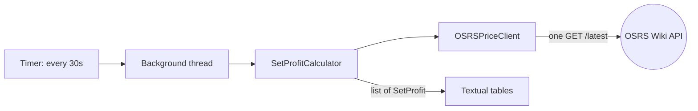

# OSRS Price Checker

[](https://github.com/Tluzanta-main/OSRS/actions/workflows/tests.yml)

A terminal dashboard that finds profitable item sets on the Old School RuneScape Grand Exchange.
Every 30 seconds it pulls live prices from the [OSRS Wiki Real-time Prices API](https://prices.runescape.wiki/)
and shows which sets are worth assembling: buy the pieces, sell the finished set, after GE tax.

<!-- TODO: add a screenshot: docs/screenshot.png -->

## How the profit is calculated

For each set:

- **Cost** = the sum of each component's *low* price (a patient buy offer)
- **Tax** = 2% of the set's *high* price, rounded down (none below 50 coins, capped at 5,000,000)
- **Net profit** = set high price − tax − cost
- **Margin** = net profit ÷ cost

Sets above 100,000 net profit get their own tab, with each component's price and how old that price is.

## How it works



- **One request per refresh.** `/latest` returns every item's price at once, and the app picks out the 52 components of its 14 sets.
- **The UI never freezes.** Fetching and math run on a background thread; results go back to the UI thread.
- **Every constant lives in `src/config.py`:** refresh rate, tax rules, profit threshold.

## Run it

Requires Python 3.12.

```bash
git clone https://github.com/Tluzanta-main/OSRS.git
cd OSRS
python -m venv .venv
.venv\Scripts\activate          # macOS/Linux: source .venv/bin/activate
pip install -r requirements.txt
python src/main.py
```

## Tests

```bash
python -m pytest -q
```

26 unit tests cover the tax rules, the profit math, missing and stale price data, and time formatting.
They never call the live API: the calculator takes its client as an argument, so tests pass in a fake one,
and a fake clock makes price ages exact. GitHub Actions runs them on every push.

## Project layout

```
src/
  main.py            entry point
  app.py             Textual app, timer, background refresh
  api.py             OSRS Wiki API client
  calculate_sets.py  GE tax and profit math
  widgets.py         the two tables
  config.py          all constants
tests/               pytest unit tests
items_sets.json      the sets and their component item IDs
```

## Known limitations

- Assumes both offers fill. Trade volume and GE buy limits aren't considered yet,
  so a set that rarely trades can look more profitable than it is.
- Sets with any missing price are hidden rather than flagged.

## API etiquette

The app identifies itself with a custom User-Agent and refreshes every 30 seconds, the same rate the Wiki updates its data,
as the [Wiki's API guidelines](https://oldschool.runescape.wiki/w/RuneScape:Real-time_Prices) ask.

## How I built this

The idea, the profit strategy and the app code are mine. I used Claude Code to help
add the test suite, CI workflow and this README; I reviewed every change and can walk
through any part of it.
